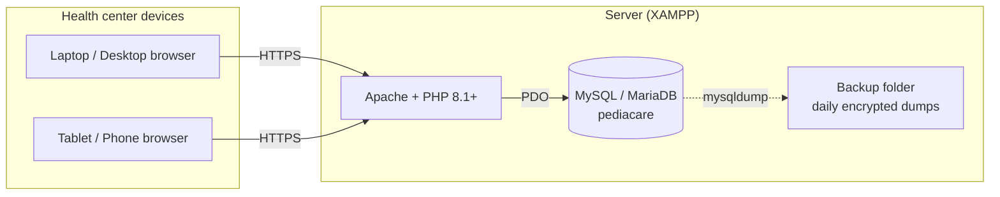
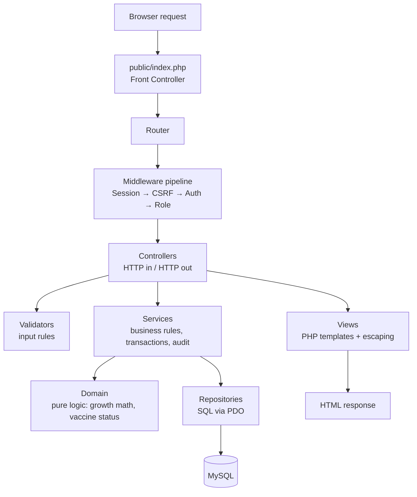

# Plan 001 — Pediacare MVP

> This is the **how** (the TRD). It implements `spec.md`. If anything here conflicts with the spec,
> the spec wins. Raise the conflict, don't resolve it silently.

---

## 1. Tech stack

| Layer | Choice | Notes |
|-------|--------|-------|
| Language | Vanilla PHP 8.1+ (no framework) | Uses PHP 8.1 enums and readonly properties |
| Web server | Apache (bundled with XAMPP) | `mod_rewrite` enabled for clean URLs |
| Database | MySQL / MariaDB (bundled with XAMPP) | InnoDB engine, `utf8mb4` charset |
| DB access | PDO with prepared statements | `ERRMODE_EXCEPTION`, `EMULATE_PREPARES = false` |
| Frontend | Server-rendered PHP templates, plain CSS, vanilla JavaScript | Bootstrap 5 (local copy, optional) for layout and forms |
| Charts | Chart.js (local copy in `public/assets/vendor/`) | Local copy so it works without internet |
| Autoloading | Composer PSR-4 | Only Composer usage besides PHPUnit |
| Tests | PHPUnit | Unit + integration (separate test database) |
| Dev environment | XAMPP | See §8 for production hardening |

---

## 2. System architecture

### 2.1 Architectural style
A **layered, server-rendered monolith** using an **MVC** structure with a **Front Controller**.
One PHP application, one MySQL database, deployed on one server. This fits a single health center,
a small team, and XAMPP hosting.

### 2.2 Deployment view



Two hosting options, to be decided per spec open question #4:
- **Local (LAN):** XAMPP runs on a dedicated PC at the health center; staff devices connect over
  the center's Wi-Fi. Works without internet. Needs local backups copied off-site regularly.
- **Online:** PHP + MySQL hosting (shared hosting or VPS). Accessible anywhere, but depends on internet.

### 2.3 Layered architecture



**Layer rules (dependencies point downward only):**

Only repositories execute SQL. Core `Database` creates and configures PDO; services
use the shared connection only to control transactions. Bootstrap and the container
wire that shared connection. `AuditLogger` and `RecordNumberGenerator` delegate SQL
to repositories.

| Layer | Responsibility | May use | Must NOT |
|-------|----------------|---------|----------|
| Front Controller / Router | Single entry point, match URL → controller | Middleware, Controllers | Contain feature logic |
| Middleware | Session, CSRF, authentication, role checks | Session, Services | Render pages (only redirect / 403) |
| Controllers | Read request, call validator + service, choose view or redirect | Validators, Services, View | Run SQL, contain business rules |
| Validators | Check and normalize form input | — | Touch the database (except uniqueness checks via a repository) |
| Services | Business rules, transactions, audit logging | Repositories, Domain, AuditLogger | Read `$_POST` / `$_SESSION` directly, echo HTML |
| Domain | Pure calculations: BMI, z-scores, classification, dose status | Other Domain classes | Use PDO, superglobals, or I/O |
| Repositories | All SQL for one table / aggregate | PDO | Contain business rules |
| Views | Display data | `e()` helper, partials | Query the database or change data |

### 2.4 Request lifecycle (example: add a measurement)
1. `POST /children/123/measurements` reaches `public/index.php` via `.htaccess` rewrite.
2. Router matches the route to `MeasurementController::store`.
3. Middleware: start session → verify CSRF token → check logged in → check role is ADMIN, STAFF, or BHW.
4. Controller passes `$_POST` data to `MeasurementValidator`. On error, re-render the form with messages.
5. Controller calls `MeasurementService::record($childId, $input, $currentUser)`.
6. Service loads the child (via `ChildRepository`), calls `GrowthCalculator` (Domain) to compute
   age, BMI, z-scores, and statuses. If the result is implausible and not confirmed, it returns
   a "needs confirmation" result.
7. Service opens a transaction → `MeasurementRepository::insert()` → `AuditLogger::log()` → commit.
8. Controller redirects to `/children/123?tab=growth` with a flash message (**Post/Redirect/Get**).

---

## 3. Design patterns

| Pattern | Where | Why |
|---------|-------|-----|
| **Front Controller** | `public/index.php` | One entry point: consistent bootstrapping, security, and error handling. No other PHP file is web-accessible. |
| **MVC** | `Controllers/`, `views/`, `Repositories/` + `Domain/` | Separates HTTP handling, display, and data/logic. |
| **Service Layer** | `src/Services/*Service.php` | Keeps business rules in one place, reusable by any controller or CLI script; owns transactions and audit logging. |
| **Repository** | `src/Repositories/*Repository.php` | All SQL lives here. Easy to find, review, and test; services don't care how data is stored. |
| **Dependency Injection** (constructor injection + small container) | `src/Core/Container.php`, `bootstrap.php` | Classes receive what they need instead of creating it. Makes classes testable (pass a fake repository in tests). No global variables or Singletons. |
| **Middleware / Chain of Responsibility** | `src/Middleware/` | Auth, role, and CSRF checks run in a fixed chain before every protected route, so they can't be forgotten in a controller. |
| **Strategy** | `src/Domain/Growth/Reference/` | `Who2006Standard` (0–60 completed months) and `Who2007Reference` (61–228 months) implement one `GrowthReference` interface. The calculator picks the right strategy by age. Classifiers per indicator follow the same idea. |
| **Value Object** | `src/Domain/` (e.g. `ZScoreResult`, `AgeInMonths`, `GrowthResult`) | Immutable (`readonly`) objects that carry validated values, so invalid data can't move between layers. |
| **Enum** (PHP 8.1) | `Role`, `Sex`, `DoseStatus`, `NutritionStatus`, `MeasurementPosition` | Replaces magic strings. |
| **Template View + Layout** | `views/layouts/main.php`, `views/partials/` | Shared header/sidebar; each page fills in content. |
| **Post/Redirect/Get** | All form submissions | Prevents duplicate records when a user refreshes after saving. |
| **Transaction Script** inside services | e.g. `ChildService::archive()` | Each use case runs as one database transaction together with its audit entry. |

Patterns intentionally **not** used: Active Record (mixes SQL into data objects), Singleton
(hidden global state, hard to test), and a full ORM (unnecessary for this size).

---

## 4. Project structure

```
pediacare/
├── AGENTS.md
├── composer.json                 # PSR-4 autoload "Pediacare\\" => "src/", PHPUnit (dev)
├── specs/001-pediacare-mvp/{spec,plan,tasks}.md
├── config/
│   ├── config.example.php        # committed template
│   └── config.local.php          # real DB credentials (gitignored)
├── public/                       # ← Apache DocumentRoot points HERE only
│   ├── index.php                 # Front Controller
│   ├── .htaccess                 # rewrite all requests to index.php
│   └── assets/{css,js,vendor}/   # Bootstrap, Chart.js (local copies)
├── src/
│   ├── bootstrap.php             # load config, autoload, build container, error handling
│   ├── routes.php                # route table: method, path, controller, middleware, roles
│   ├── Core/                     # Router, Request, Response, View, Database, Container,
│   │                             # Session, Csrf, Flash
│   ├── Middleware/               # AuthMiddleware, RoleMiddleware, CsrfMiddleware
│   ├── Controllers/              # AuthController, ChildController, MeasurementController,
│   │                             # ImmunizationController, VisitController, ReportController,
│   │                             # Admin/{User,Purok,Schedule,Audit}Controller
│   ├── Validation/               # ChildValidator, MeasurementValidator, ...
│   ├── Services/                 # ChildService, MeasurementService, ImmunizationService,
│   │                             # VisitService, ReportService, UserService, AuthService
│   ├── Repositories/             # UserRepository, ChildRepository, MeasurementRepository, ...
│   ├── Domain/
│   │   ├── Growth/               # GrowthCalculator, Reference/{GrowthReference,
│   │   │                         # Who2006Standard, Who2007Reference}, Classifier, LmsTable
│   │   ├── Immunization/         # DoseStatusCalculator, FicChecker
│   │   └── Enums/
│   └── Support/                  # AuditLogger, RecordNumberGenerator, helpers (e(), csrf_field())
├── views/
│   ├── layouts/  partials/  auth/  children/  measurements/
│   ├── immunizations/  visits/  reports/  admin/  errors/
├── database/
│   ├── migrations/               # 001_create_users.sql, 002_create_puroks.sql, ...
│   ├── seeds/                    # vaccine schedule, fake demo data
│   └── who/                      # WHO LMS reference CSVs + README with source
├── bin/
│   ├── migrate.php               # applies new migrations, records them in `migrations` table
│   ├── seed.php
│   └── backup.php                # mysqldump + encryption
├── storage/logs/                 # gitignored
├── tests/
│   ├── Unit/                     # Domain, validators, services with fake repositories
│   └── Integration/              # repositories + services against `pediacare_test` DB
└── docs/                         # deploy.md, backup.md, qa-checklist.md
```

**Important for XAMPP:** point Apache's DocumentRoot (or a VirtualHost) to `pediacare/public`,
not `pediacare/`. Otherwise `config/`, `src/`, and `database/` become downloadable from the browser.

---

## 5. Database design (MySQL, InnoDB, utf8mb4)

```
users           id PK, name, email UNIQUE, password_hash, role ENUM('ADMIN','STAFF','BHW','VIEWER'),
                active TINYINT, last_login_at, created_at, updated_at
login_attempts  id PK, email, ip_address, attempted_at, success TINYINT
puroks          id PK, name UNIQUE
children        id PK, record_no UNIQUE, first_name, middle_name, last_name, suffix,
                sex ENUM('M','F'), date_of_birth DATE, place_of_birth, purok_id FK, address,
                mother_name, father_name, guardian_name, guardian_relation, contact_no,
                philhealth_no, birth_weight_kg DECIMAL(4,2), birth_length_cm DECIMAL(4,1), notes,
                archived_at, archive_reason, created_by FK users, created_at, updated_at
record_counters year PK, last_number
measurements    id PK, child_id FK, measured_at DATE, weight_kg DECIMAL(5,2), height_cm DECIMAL(5,1),
                position ENUM('LYING','STANDING'), muac_cm DECIMAL(4,1) NULL, age_months INT,
                bmi DECIMAL(5,2), wfa_z, hfa_z, wfh_z, bmi_z DECIMAL(5,2) NULL,
                wfa_status, hfa_status, wfh_status, bmi_status VARCHAR NULL,
                implausible_confirmed TINYINT, measured_by FK users, created_at
vaccines        id PK, code UNIQUE, name, active TINYINT
schedule_doses  id PK, vaccine_id FK, dose_number, recommended_age_days, grace_days,
                recommended_age_months, min_interval_days, min_interval_months,
                counts_toward_fic TINYINT, sort_order
immunizations   id PK, child_id FK, schedule_dose_id FK, date_given DATE, lot_number, site,
                given_elsewhere TINYINT, place_given, given_by FK users, created_at
                UNIQUE (child_id, schedule_dose_id)
visits          id PK, child_id FK, visit_date DATE, reason, findings, actions,
                referred TINYINT, referred_to, attended_by FK users, notes, created_at
supplements     id PK, visit_id FK, type ENUM('VITAMIN_A','DEWORMING','IRON','MNP','OTHER'),
                dose, date_given DATE
who_lms         id PK, reference ENUM('WHO2006','WHO2007'), indicator, sex, age_or_size DECIMAL,
                l, m, s DECIMAL(10,6)   INDEX (reference, indicator, sex, age_or_size)
audit_logs      id PK, user_id FK, action ENUM('CREATE','UPDATE','ARCHIVE','RESTORE'),
                entity, entity_id, changes JSON, ip_address, created_at
migrations      id PK, filename UNIQUE, applied_at
```

Indexes: `children(last_name, first_name)`, `children(date_of_birth)`, `children(purok_id)`,
`measurements(child_id, measured_at)`, `immunizations(child_id)`, `audit_logs(entity, entity_id)`.

---

## 6. Key logic

### 6.1 Authorization
- Routes declare allowed roles in `routes.php`; `RoleMiddleware` enforces them and returns 403.
- The permission matrix mirrors spec §3 and lives in one place (`src/Support/Permissions.php`)
  so views can also hide buttons. **The middleware check is the real guard.**

### 6.2 Growth calculations (`src/Domain/Growth/`)
- Pure classes, fully unit-tested, no database access (LMS data is passed in via an `LmsTable` object
  loaded by a repository).
- **Age** in completed days and calendar months from date of birth to measurement date.
  Clinical reference selection and WHO2007 interpolation use WHO months = days / 30.4375
  (WHO AnthroPlus manual §3.2.1). WHO2006 uses exact days 0–1856; WHO2007 starts at day 1857.
  Registry age groups and report eligibility retain completed calendar months.
- **BMI** = weight_kg / (height_m²).
- **Length vs. height:** WHO standards use length (lying) under 24 months and height (standing) from
  24 months. If the position doesn't match, apply the WHO 0.7 cm adjustment.
- **Z-scores** by the LMS method using WHO tables (in `database/who/`, loaded into `who_lms`):
  - 0–60 months: WHO Child Growth Standards (2006): weight-for-age, length/height-for-age,
    weight-for-length, weight-for-height, BMI-for-age.
  - 61 months–19 years: WHO Growth Reference (2007): BMI-for-age, height-for-age
    (weight-for-age up to 10 years only).
  - Use the WHO-recommended restricted LMS adjustment for weight-based indicators beyond ±3 SD.
- Source tables: official WHO LMS files. Record the source URL and download date in `database/who/README.md`.

### 6.3 Classification cut-offs (to be confirmed with the nurse/nutritionist)

**WHO2006 (0–60 completed WHO months; OPT+ reporting remains 0–59 calendar months):**

| Indicator | Category | Z-score |
|-----------|----------|---------|
| Weight-for-age | Severely underweight | < −3 |
| | Underweight | −3 to < −2 |
| | Normal | −2 to +2 |
| | High weight-for-age | > +2 |
| Length/height-for-age | Severely stunted | < −3 |
| | Stunted | −3 to < −2 |
| | Normal | −2 to +3 |
| | Tall | > +3 |
| Weight-for-length/height | Severely wasted | < −3 |
| | Wasted | −3 to < −2 |
| | Normal | −2 to +2 |
| | Overweight | > +2 to +3 |
| | Obese | > +3 |

WHO2006 BMI-for-age uses the same bands and labels as weight-for-length/height
above. The height-for-age bands apply to both references. Weight-for-age bands
apply wherever that indicator is available (WHO2007 through 120 completed WHO
months). A high weight-for-age result is not an overweight diagnosis; assess
weight-for-length/height or BMI-for-age instead.

**61 completed WHO months and older (WHO 2007), BMI-for-age:**
Severe thinness < −3; Thinness −3 to < −2; Normal −2 to +1; Overweight > +1 to +2; Obese > +2.

These are the project's approved category bands. WHO's growth-assessment
training also describes a possible-risk-of-overweight band above +1 for
WHO2006; this MVP retains its specified Normal band through +2. Clinical
confirmation of these categories is still required before go-live.
Sources: [WHO growth-assessment training, Session 15](https://iris.who.int/bitstream/10665/77944/4/9789241504812_Participants_manual_eng.pdf?ua=1)
and [WHO AnthroPlus manual, §3.3](https://www.who.int/docs/default-source/child-growth/growth-reference-5-19-years/who-anthroplus-manual.pdf).

**Implausible values (flag for confirmation):** WFA z < −6 or > +5; HFA z < −6 or > +6;
WFH z < −5 or > +5; BMI-for-age z < −5 or > +5.

**Test cases:** at least 10 reference cases (age, sex, weight, height → expected z-scores) taken
from WHO Anthro software output, in `tests/Unit/Domain/GrowthReferenceTest.php` (AC-06).

### 6.4 Immunization logic (`src/Domain/Immunization/`)
- `DoseStatusCalculator::calculate(DateTimeImmutable $birthDate, array $scheduleDoses, array $immunizations, DateTimeImmutable $today)`
  returns a `DoseStatus` per dose:
  - GIVEN: a matching immunization record exists.
  - UPCOMING: today is before DOB plus the configured recommended age (days or calendar months).
  - DUE: within [recommended date, recommended date + grace_days].
  - OVERDUE: past that window and not given.
- For dose N > 1, also respect the configured minimum interval (days or calendar months) after dose N−1.
- `FicChecker::isFullyImmunized()` = every dose with `counts_toward_fic = 1` is GIVEN.
- Defaulter list: `ImmunizationService` loads children in batches and runs the calculator.

**Approved status and eligibility rules (2026-10-10):**
- Status follows recommended age plus grace even if the minimum interval has
  not elapsed, preserving AC-07. Eligibility is calculated separately: the
  earliest permitted date is the later of the recommended date and the previous
  dose date plus the configured minimum interval. A missing previous dose blocks
  eligibility for dose N > 1.
  `earliestEligibleDates($birthDate, $scheduleDoses, $immunizations)` returns
  dates keyed by schedule dose ID, or `null` when the previous dose is missing.
  The caller supplies schedule rows and immunizations for one child. Dates use
  calendar dates independent of time of day and timezone offsets.
- Calendar-month addition clamps the day to the target month's last day
  (for example, January 31 plus one month is February 28, or 29 in a leap year).
- An empty FIC configuration returns false; otherwise every configured FIC dose
  must be GIVEN. This remains configured completion, not a clinical certification.

**Approved draft seed conventions (2026-10-10):**
- Recommended ages and minimum intervals use either days or calendar months.
  Add nullable `recommended_age_months` and `min_interval_months`; exactly one
  field in each days/months pair is populated. Weeks convert to seven days;
  month-based dates use calendar arithmetic, never approximate day conversions.
  A first dose has `min_interval_days = 0` and `min_interval_months = NULL`.
  The calculator uses the populated unit when calculating due dates and intervals.
- Seed `grace_days = 0` for every dose. This is an editable software default,
  not a DOH clinical rule or permission to administer vaccines early.
- Minimum intervals: Pentavalent, bOPV, PCV and MMR/MR subsequent doses: 28 days;
  IPV dose 2: four calendar months under WHO's preferred bOPV-plus-IPV schedule.
- Seed FIC membership for BCG, all three Pentavalent doses, all three bOPV
  doses, and both MMR/MR doses (nine doses). Hepatitis B birth dose, IPV and PCV
  remain scheduled but do not count toward this draft completion flag.
- The MVP FIC flag means completion of configured doses, as specified in
  `spec.md`; it does not implement DOH's age-limited FIC reporting definition.
- Date-only birth-dose records cannot prove administration within 24 hours.
  The Hepatitis B birth dose is scheduled at age zero; retain its clinical
  within-24-hours label without claiming exact-hour validation.
- Re-running the seed inserts missing entries without overwriting Admin edits.
  Keep the seed marked DRAFT until the center confirms its schedule.

Sources reviewed 2026-10-10:
[WHO routine immunization table, December 2025](https://cdn.who.int/media/docs/default-source/immunization/immunization_schedules/immunization-summary-table-2.pdf)
(routine series intervals, including preferred IPV schedule), and
[DOH January 2025 FIC description](https://ro12.doh.gov.ph/%F0%9D%90%83%F0%9D%90%8E%F0%9D%90%87-%F0%9D%90%94%F0%9D%90%8D%F0%9D%90%88%F0%9D%90%82%F0%9D%90%84%F0%9D%90%85-%F0%9D%90%96%F0%9D%90%87%F0%9D%90%8E-%F0%9D%90%87%F0%9D%90%88%F0%9D%90%86%F0%9D%90%87/)
(draft FIC membership; reporting timing remains outside this MVP flag).

**Default seed schedule (DRAFT — verify against current DOH EPI guidance before go-live):**

| Vaccine | Doses | Recommended age |
|---------|-------|-----------------|
| BCG | 1 | At birth |
| Hepatitis B (birth dose) | 1 | Within 24 hours of birth |
| Pentavalent (DPT-HepB-Hib) | 3 | 6, 10, 14 weeks |
| Oral polio vaccine (bOPV) | 3 | 6, 10, 14 weeks |
| Inactivated polio vaccine (IPV) | 2 | 14 weeks, 9 months |
| Pneumococcal conjugate (PCV) | 3 | 6, 10, 14 weeks |
| Measles-containing (MMR/MR) | 2 | 9 months, 12 months |

### 6.5 Audit logging
- `AuditLogger::log(int $userId, AuditAction $action, string $entity, int $entityId, array $before, array $after)`
  is called by services **inside the same transaction** as the change and delegates
  persistence to an audit repository using the shared PDO connection.
- Store only changed fields in `changes` (JSON).

### 6.6 Record numbers
- `PC-{year}-{5-digit sequence}`, generated by `RecordNumberGenerator` using
  a repository that executes `SELECT ... FOR UPDATE` on `record_counters` inside
  a transaction to prevent duplicates.

---

### 6.7 Nutritional summary rules (approved 2026-10-11)
- Reporting dates are inclusive. Select each child's latest measurement inside
  that period, breaking same-date ties by the greatest measurement ID.
- Count that child once only if their age on the selected measurement date is
  0–59 completed calendar months. Do not fall back to an earlier measurement
  when the selected measurement is outside the age range. Children without a
  measurement in the period are excluded.
- Count saved WFA, HFA, WFH and BMI-for-age classifications separately, without
  recalculating them. Missing classifications count as `Not available`.
- Exclude currently archived children unless `Include archived` is selected.
  Sex, purok and date of birth use the current child record.
- Admin and Staff see barangay totals and purok breakdowns, each split by sex.
  Viewer sees barangay totals split by sex only; Viewer queries must not return
  purok identifiers or names and cannot be narrowed to a purok.

### 6.8 Monthly immunization summary rules (approved 2026-10-11)
- Count recorded doses whose date given falls within the selected calendar month,
  including doses given elsewhere and historical records for inactive vaccines.
- FIC counts children completing all currently configured FIC doses during that
  month: the latest date among those required doses is the completion date.
  Earlier completions are not counted again. An empty FIC configuration counts zero.
  Use the configured completion definition in §6.4 without adding age restrictions.
- Exclude currently archived children unless `Include archived` is selected.
- Admin, Staff and Viewer see barangay-wide aggregate totals split by current sex,
  without child identifiers or purok filters. Current schedule edits can change
  historical FIC counts; this is not a frozen DOH reporting definition.

## 7. Security and privacy (vanilla PHP specifics)
- **SQL injection:** PDO prepared statements only; `PDO::ATTR_EMULATE_PREPARES = false`.
- **XSS:** every output through `e()` = `htmlspecialchars($v, ENT_QUOTES, 'UTF-8')`.
- **CSRF:** per-session token in every POST form; `CsrfMiddleware` rejects mismatches.
- **Passwords:** `password_hash()` with `PASSWORD_ARGON2ID` if available, else `PASSWORD_DEFAULT`;
  `password_verify()`; rehash with `password_needs_rehash()`.
- **Sessions:** `session.cookie_httponly=1`, `session.cookie_samesite=Lax`,
  `session.cookie_secure=1` when on HTTPS, `session.use_strict_mode=1`;
  `session_regenerate_id(true)` on login; 30-minute idle timeout.
- **Login rate limit:** max 5 failed attempts per email/IP per 15 minutes (`login_attempts` table).
- **Errors:** `display_errors=Off` in production; log to `storage/logs` without personal data;
  show a generic error page.
- **Security headers:** `X-Frame-Options: DENY`, `X-Content-Type-Options: nosniff`,
  `Referrer-Policy: same-origin`, a basic Content-Security-Policy.
- **Backups:** daily `mysqldump`, encrypted, copied off the server. Test a restore before go-live.

---

## 8. XAMPP notes
XAMPP is designed for **development**, and its defaults are insecure. If XAMPP is also used in
production at the health center:
- Set a password for MySQL `root`, and create a dedicated `pediacare_app` user with only
  SELECT/INSERT/UPDATE/DELETE on the `pediacare` database.
- Restrict or remove phpMyAdmin and the XAMPP dashboard so only localhost can reach them.
- Point DocumentRoot to `public/` (see §4).
- Enable HTTPS (a self-signed certificate is acceptable on a closed LAN; use a real certificate if online).
- Turn off `display_errors`, and stop unused services (FileZilla, Mercury, Tomcat).
- Never expose the XAMPP machine directly to the internet.

---

## 9. Testing strategy
- **Unit (PHPUnit):** Domain (growth math, classification, dose status, FIC), validators,
  permission matrix, and services using fake in-memory repositories.
- **Integration (PHPUnit):** repositories and services against a separate `pediacare_test`
  database, reset before each test run (checks audit logs, transactions, role enforcement).
- **End-to-end:** a written QA checklist in `docs/qa-checklist.md` run by hand before each release
  (login → register → measure → vaccinate → report). Playwright can be added later.
- Each test method references its acceptance criterion id (AC-xx).

---

## 10. Risks

| Risk | Mitigation |
|------|------------|
| Wrong z-score math gives wrong nutrition status | Official WHO LMS tables; reference tests against WHO Anthro output |
| Outdated vaccine schedule | Schedule is admin-editable data; verify with RHU before go-live |
| Security mistakes are easier without a framework | Central middleware, `e()` helper, prepared statements only, security review task (T38) |
| Insecure XAMPP defaults | Hardening checklist in §8 and `docs/deploy.md` |
| Single PC server fails or is stolen | Encrypted daily backups stored off-site; documented restore procedure |
| Duplicate child records | Duplicate warning on registration (AC-04) |
